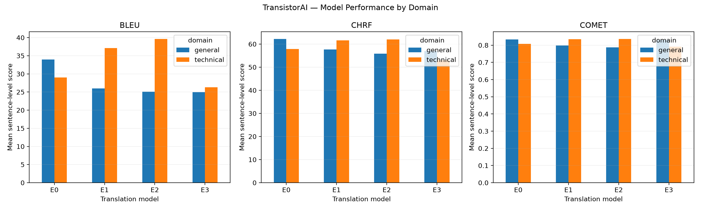
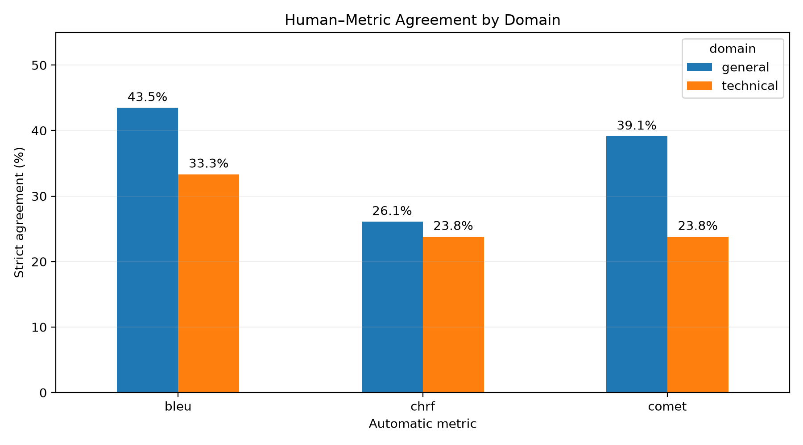
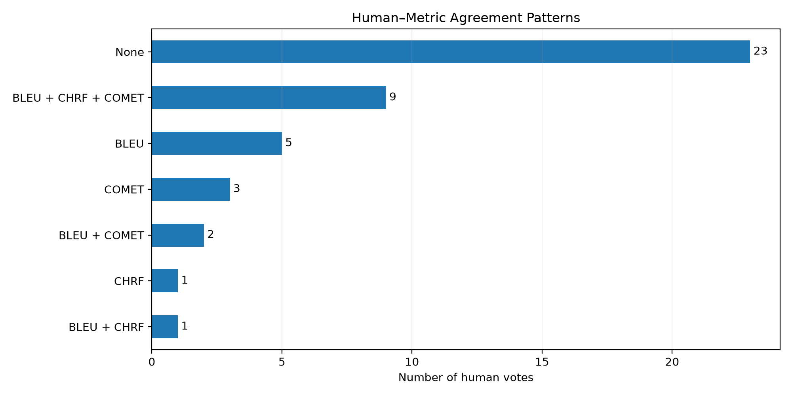

# Day 19 — Human Preferences vs Automatic Translation Metrics

## 1. Objective

Evaluate how well BLEU, chrF and COMET rankings align with human translation preferences across four German-to-English translation systems.

## 2. Models

| Model | Description |
|---|---|
| E0 | Baseline NMT |
| E1 | Technical-domain fine-tuned NMT |
| E2 | Mixed-domain fine-tuned NMT |
| E3 | Qwen2.5-3B-Instruct LLM baseline |

## 3. Evaluation Methodology

The human evaluation dataset contains German source sentences, English references and translations generated by E0–E3.

Participants selected their preferred translation without relying on automatic metric scores.

The analysis includes:

- 44 human votes from 3 participants
- 40 unique sentences
- 19 general-domain sentences
- 21 technical-domain sentences
- 160 model–sentence metric scores
- 132 human–metric comparisons

For each vote, the selected translation was compared against the highest-scoring distinct translation under BLEU, chrF and COMET.

Identical model outputs were grouped to avoid counting duplicate translations as independent candidates.

Strict agreement gives full credit if the selected translation is among the metric winners. Fractional agreement divides that credit by the number of tied winning translations.

## 4. Automatic Metric Results

The following values are means of sentence-level scores on the 40 human-evaluated sentences, not corpus-level scores.

| Domain | Model | BLEU | chrF | COMET |
|---|---|---:|---:|---:|
| General | E0 | 33.94 | 62.22 | 0.8331 |
| General | E1 | 25.96 | 57.61 | 0.7981 |
| General | E2 | 25.08 | 55.88 | 0.7876 |
| General | E3 | 24.94 | 56.93 | 0.8310 |
| Technical | E0 | 29.02 | 57.88 | 0.8071 |
| Technical | E1 | 37.12 | 61.60 | 0.8352 |
| Technical | E2 | 39.64 | 61.96 | 0.8364 |
| Technical | E3 | 26.30 | 53.02 | 0.7915 |

## 5. Human–Metric Agreement

| Metric | Overall | General | Technical |
|---|---:|---:|---:|
| BLEU | 38.64% | 43.48% | 33.33% |
| chrF | 25.00% | 26.09% | 23.81% |
| COMET | 31.82% | 39.13% | 23.81% |

BLEU achieved the highest observed strict agreement with human selections in this sample.

However, the sample is too small and participant-imbalanced to establish that BLEU is generally superior to COMET or chrF.

## 6. Agreement Patterns

| Pattern | Votes |
|---|---:|
| No metric agrees | 23 |
| All three agree | 9 |
| BLEU only | 5 |
| COMET only | 3 |
| BLEU + COMET | 2 |
| BLEU + chrF | 1 |
| chrF only | 1 |

In 23 of 44 votes (52.3%), none of the automatic metrics selected the human-preferred translation as a top-ranked candidate.

## 7. Qualitative Error Analysis

### HE0005 — General: Natural phrasing

Human preference: E3.

BLEU selected E3, while chrF and COMET selected E0.

Both translations preserved the earthquake and tsunami death toll. E3 used natural reporting language, while the COMET scores of E0 and E3 were very close.

### HE0129 — Technical: Interface terminology

Human preference: E1.

BLEU selected E1, while COMET selected E2.

The reference contains an additional explanation about the encoding applying only to the current document, which is not present in the German source. This is a reference-quality limitation.

### HE0114 — General: Semantic coherence

Human preference: E0.

COMET selected E0, while BLEU and chrF selected E3.

E3 contained the awkward phrase "amid his West's chatter". E0 better preserved the relationship between the footage, West's remarks and Chris Rock.

### HE0142 — General: Fluent paraphrasing

Human preference: E3.

COMET selected E3, while BLEU and chrF selected E0.

E3 expressed the meaning of opposition to submission more naturally. E0 used a more literal but awkward formulation.

### HE0044 — Technical: Bandwidth and markup

Human preference: E0.

BLEU and COMET selected E1, while chrF selected E2.

E0–E2 preserved the central bandwidth warning. E3 introduced a meaning reversal concerning local networks. Markup such as `& eg;` also requires attention.

### HE0056 — Technical: Terminology

Human preference: E3.

BLEU and chrF selected E2, while COMET selected E0.

E3 used "color progression" rather than the conventional technical term "gradient". The reference also contained feature-name information absent from the German source.

This demonstrates that human preference and technical correctness are not necessarily equivalent.

## 8. Limitations

1. Only 44 votes from 3 participants were available.
2. One participant contributed 40 of the 44 votes.
3. Only 40 unique sentences were evaluated.
4. Repeated votes on some sentences limit statistical independence.
5. Some references contain information not present in the German source.
6. Human preference is not equivalent to an independently verified correctness judgment.
7. Sentence-level BLEU and chrF results should not be confused with corpus-level scores.
8. The human-evaluated subset may not represent the full general and technical test sets.

## 9. Conclusions

BLEU showed the highest observed agreement with human preferences in this exploratory sample.

COMET nevertheless aligned with human selections in several examples where lexical metrics favored less coherent translations.

Technical translation evaluation remains challenging because of terminology, formatting, reference quality and differences between semantic accuracy and human preference.

The results support combining automatic metrics with targeted human review rather than relying on a single evaluation metric.

## 10. Reproducibility

Day 19 evaluation files:

- `results/day19_human_metrics/sentence_level_metrics.csv`
- `results/day19_human_metrics/human_metric_comparison.csv`
- `results/day19_human_metrics/metric_agreement_summary.csv`
- `results/day19_human_metrics/metric_disagreements.csv`
- `results/day19_human_metrics/figures/`

Human evaluation data:

- `data/human_evaluation/preference_dataset.csv`
- `data/human_evaluation/preference_votes.sqlite3`

Evaluation logic reused from:

- `evaluation/day17_compare_human_metrics.py`
